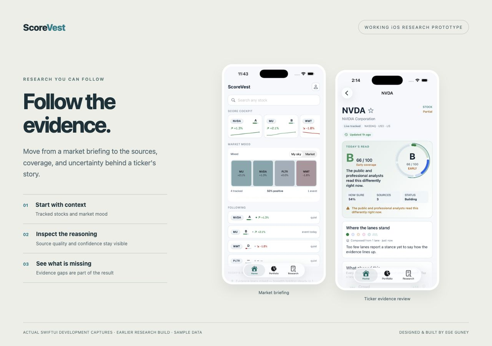
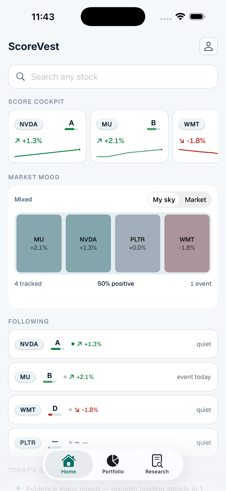
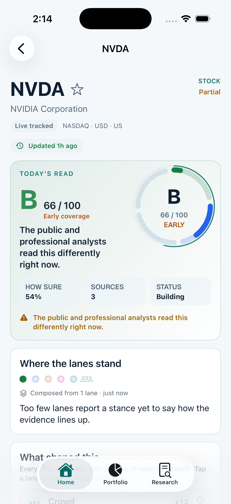
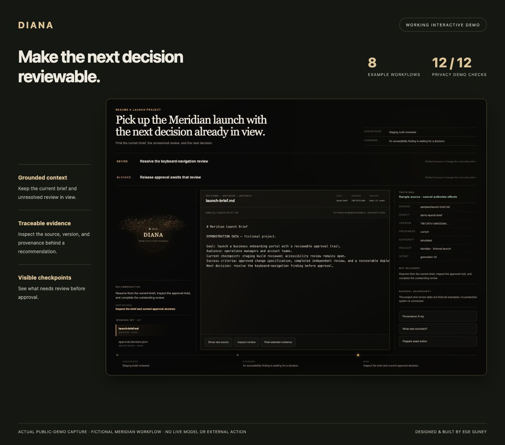
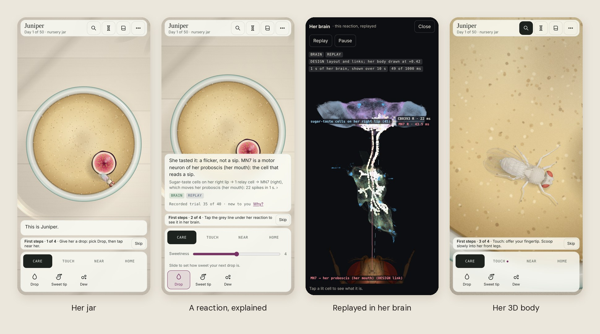
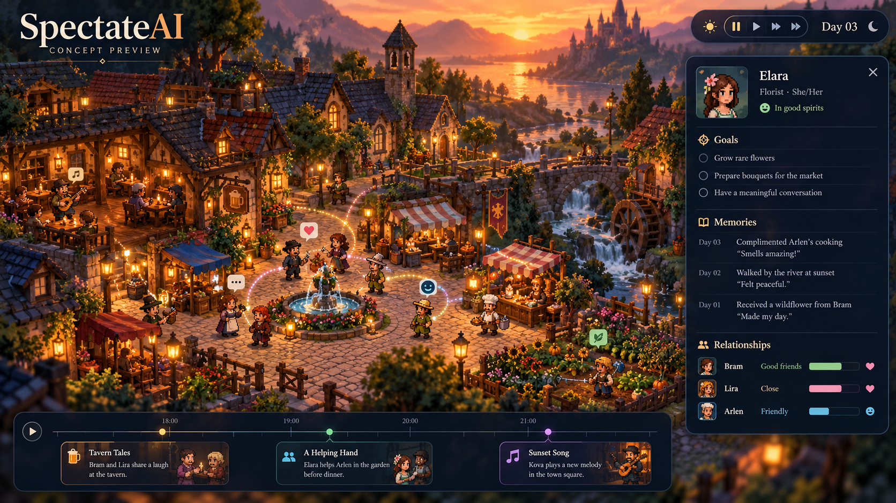
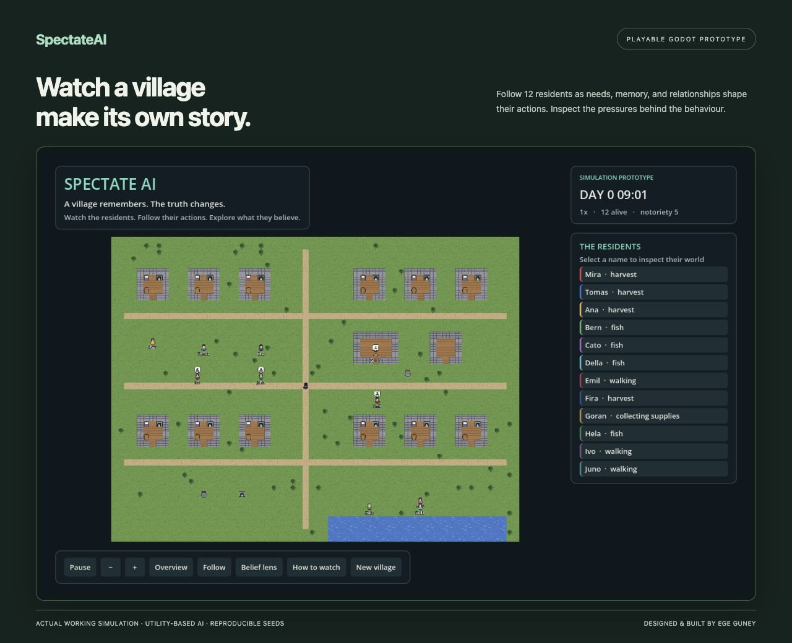
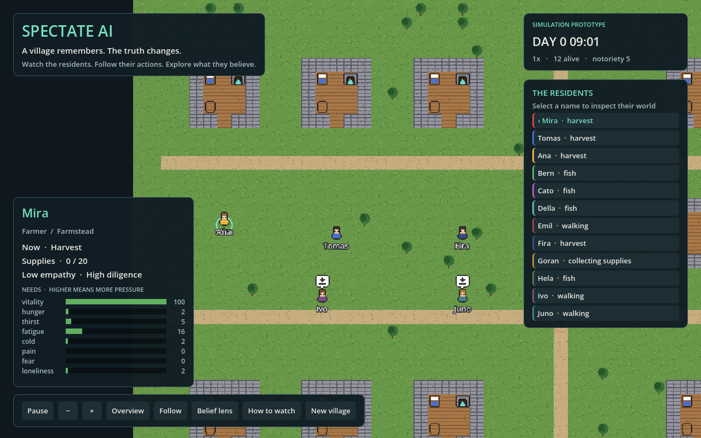
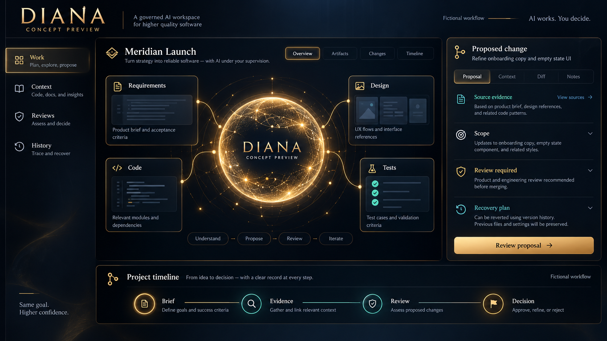

# Ege Guney — Project Showcase

**AI Engineering · Strategic Analytics**

A public portfolio connecting enterprise software experience with evidence-based financial research, governed AI interfaces, and connectome simulation.

**[Open the showcase](https://ege-guney.github.io/project-showcase/)** · [ScoreVest case study](https://ege-guney.github.io/project-showcase/scorevest/) · [DIANA live demo](https://ege-guney.github.io/project-showcase/diana/) · [Perch live demo](https://ege-guney.github.io/project-showcase/perch/)

## Explore the projects

- **ScoreVest:** investment research and portfolio analytics combining cited sources, explicit evidence gaps, and cost-aware paper simulations. The public page is an overview; the application source remains private.
- **DIANA Preview:** an interactive Holo workspace showing evidence review, approval boundaries, source provenance, and recovery using entirely fictional Meridian workflows. The privacy workbench classifies sensitivity, redacts identifiers, and generates preview receipts locally.
- **Perch:** a pet fruit fly whose every reaction replays a recorded trial of a spiking (leaky integrate-and-fire) model run on the BANC connectome, the mapped brain and nerve cord of one real fly: 169,078 neurons, 3,542 recorded trials across three sister flies. Any reaction can be opened to watch it travel through her brain in 3D. The built app and its data are in [`dist/perch/app/`](dist/perch/app/); the lab pipeline that runs the model is not included.
- **SpectateAI** (other work): a working Godot village simulation driven by needs, beliefs, traits, and relationships. Playback, follow, overview, and belief-lens controls make emergent behavior inspectable. The concept artwork presents a future visual direction; it does not represent implemented graphics or language-model features.

## Demo scope

DIANA is an interface and privacy prototype using synthetic examples. It is not connected to a live model, private ledger, or autonomous tools. SpectateAI currently uses utility-based AI; language-model integration is planned. ScoreVest does not display personal holdings or verified investment-performance claims. Perch labels every claim BRAIN, REPLAY or DESIGN; nothing in it is a BANC measurement, and its cell-type names are for non-commercial use (see [`dist/perch/app/brain/NOTICE.md`](dist/perch/app/brain/NOTICE.md)).

## Local preview

Run `python3 rebuild-game.py` to restore the verified WebAssembly engine from the compressed source chunks, then serve `dist/` with any static HTTP server. Routes: `/`, `/scorevest/`, `/diana/`, `/privacy/`, `/perch/` (app at `/perch/app/`) and `/spectate/`. All paths are relative, so the site also works from a subfolder such as GitHub Pages. Godot Web export requires WebAssembly and WebGL2.

To rebuild the DIANA interface, install the pinned dependencies in `diana-src/` and run `npm run build`. The SpectateAI build is exported from the private game source using Godot 4.7.1 with the Compatibility renderer and single-threaded Web export.

## Attribution

Designed and built by [Ege Guney](https://github.com/Ege-Guney). The SpectateAI future-direction artwork was generated with AI as a clearly labeled concept preview.

## Project visuals

ScoreVest and DIANA lead with actual application captures, presented with consistent framing and short workflow captions. SpectateAI leads with its clearly labeled future art direction, with working gameplay captures available below.

### ScoreVest — research in a native iOS interface

Inspect the original iOS captures

<table><tr><td></td><td></td></tr><tr><td>Market briefing</td><td>Ticker evidence and uncertainty</td></tr></table>

*Actual iOS development captures from an earlier working research build. Home uses demo fixtures; market figures are sample development data.*

### DIANA — inspect evidence before approving work

*Captured from the public Holo demo with synthetic Meridian examples. [Full workspace](dist/images/diana-working-demo.jpg) · [Privacy workbench](dist/images/diana-privacy-demo.jpg).*

### Perch — a pet fruit fly with a real fly's wiring

*Captures from the live app. Brain data: BANC (Bates, Phelps, Kim, Yang et al. 2026, Nature), CC BY 4.0. Body: flybody (Vaxenburg et al. 2025) and walk: FlyGym (Wang-Chen et al. 2024), Apache-2.0. Model after Shiu et al. 2024. Full credits on the [Perch page](https://ege-guney.github.io/project-showcase/perch/#credits) and in [`dist/perch/app/3d/NOTICE.md`](dist/perch/app/3d/NOTICE.md).*

### SpectateAI — an inspectable village, with a future art direction

*AI-generated future visual concept. The playable demo uses utility-based AI and current prototype graphics.*

See the working gameplay prototype

*Actual Godot prototype with 12 residents and interactive playback controls.*

Inspect a resident in the working demo

## Optional future concepts

These secondary AI-generated images explore possible future directions. They are separate from the working screenshots above.

Future ScoreVest design direction

*AI-generated concept. Illustrative data and proposed interface.*

Future DIANA design direction

*AI-generated concept. Fictional workflow and proposed interface.*

